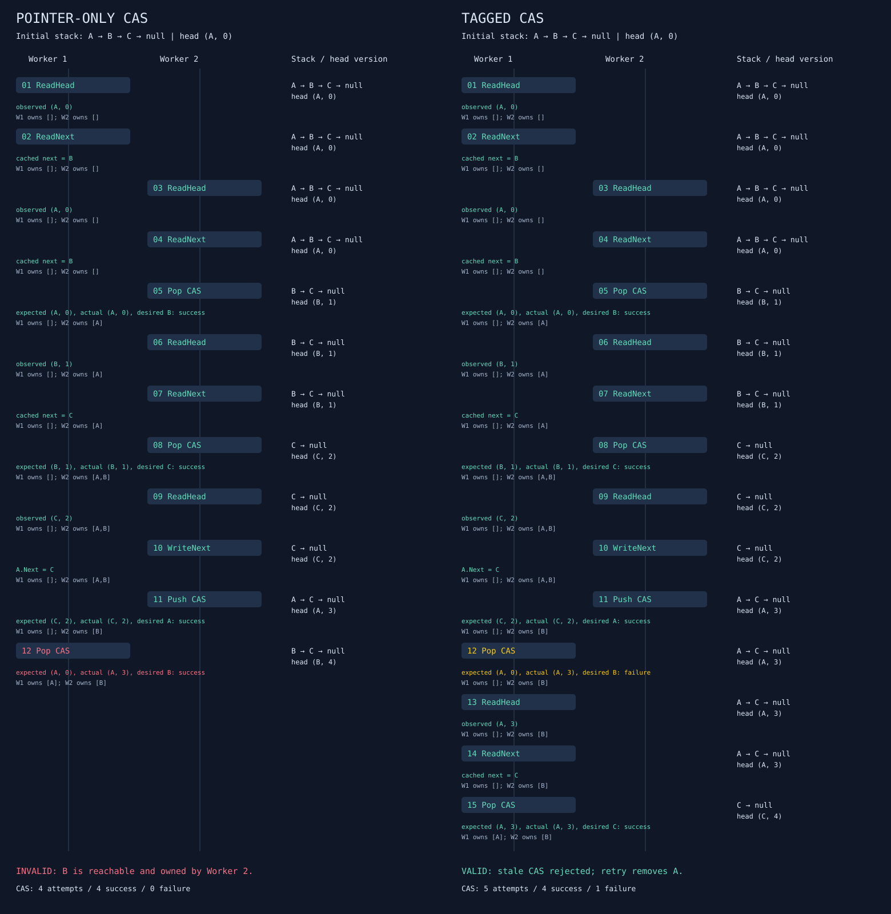

# aba-tagged-pointer

A dependency-free **.NET 10** simulator of the ABA problem in a Treiber-style stack. A successful compare-and-swap can publish an outdated link even when the CAS instruction behaves correctly.

The project runs a deterministic failure, compares pointer-only CAS with tagged CAS, enumerates bounded two-worker schedules, checks invariants after every microstep, and generates JSON and SVG reports.

## Run

Install the .NET 10 SDK. From the repository root:

```powershell
dotnet run --project src/AbaTaggedPointer -c Release -- demo
dotnet run --project src/AbaTaggedPointer -c Release -- explore
dotnet run --project src/AbaTaggedPointer -c Release -- verify
```

For the complete build, verification, report generation, and CLI smoke checks:

```powershell
./verify.ps1
```

No external NuGet packages, services, threads, or GitHub Actions are required. `verify` is a custom executable verification suite; use it instead of `dotnet test`.

## The reproducible failure

Initially: `head → A → B → C → null`.

1. Worker 1 reads head `A`, then caches `A.Next = B`.
2. Worker 2 pops `A`, pops `B`, and keeps ownership of `B`.
3. Worker 2 pushes the same node `A`, first writing `A.Next = C`.
4. Worker 1 attempts CAS from its cached head `A` to its cached next `B`.

Pointer-only CAS succeeds and installs `B → C`. This chain is acyclic, but `B` is both reachable and owned by Worker 2. The logical stack should contain only `C`. Checking for cycles alone would miss the failure.

With tagged CAS, the head changes `(A,0) → (B,1) → (C,2) → (A,3)`. Worker 1 expects `(A,0)`, so its CAS fails. It retries with fresh reads and correctly removes `A`, leaving `(C,4)`.

| Canonical demonstration | Pointer-only | Tagged |
|---|---:|---:|
| CAS attempts | 4 | 5 |
| Successful CAS | 4 | 4 |
| Failed CAS | 0 | 1 |
| Reachable nodes at end | B, C | C |
| Invalid states detected | 1 | 0 |



The same initial 12 worker choices are replayed for both strategies. Tagged execution then finishes Worker 1's retry. Red marks the invalid successful CAS; yellow marks the rejected stale CAS. Every row shows the reachable stack, head version, and ownership after the operation.

## Simulation contract

Node IDs are stable integers (`0=A`, `1=B`, `2=C`), not memory addresses. Nodes live for the whole simulation; reads through a stale identity are allowed. Each worker has a program counter, cached head/version/next, and a set of owned nodes.

The fixed workload is:

- Worker 1: pop once.
- Worker 2: pop twice, retain the second node, then reinsert its **first removed node**. Depending on the schedule that node can be `A` or `B`.

A pop has three scheduling points: `ReadHead`, `ReadNext`, `Pop CAS`. An empty pop completes at `ReadHead`. A push has `ReadHead`, `WriteNext`, `Push CAS`. Failed CAS restarts at `ReadHead`, so a retried push also rewrites its next link. Operation completion and ownership transfer occur in the successful CAS microstep; there is no separately scheduled return step.

All simulated steps execute sequentially under the scheduler. Reads and CAS are indivisible model operations. Tagged CAS compares and replaces the head identity/version pair together. The primary version counter is `BigInteger`, so it never wraps. The pointer-only strategy also records versions for explanation and checking, but **ignores them when comparing heads**.

A separate list-based reference stack changes only on successful CAS: pop removes the logical top, push inserts the worker-owned node. It never follows the linked nodes' `Next` fields. After every microstep the simulator checks:

- Known head/next node identities and no reachable cycles.
- Exact reachable order and membership against the reference list.
- No reachable-and-owned node, multiple ownership, or lost node.
- Ownership before writing a node for a push.
- Exactly one version increment per successful CAS.
- No head/link/version mutation from a failed CAS.

A stale cached value alone is legal. The execution stops on its first invariant violation, before later operations could conceal or compound it. Initial state validity is verified separately.

This is an educational model, **not a production concurrent stack**. It does not implement real atomics, memory ordering, reclamation, hazard pointers, allocation races, finite-width tag wraparound, or a proof for arbitrary workloads. Model atomicity of a composite head does not imply any particular .NET representation has hardware atomicity. The runtime metric measures simulator work, not concurrent throughput.

## Bounded exploration and metrics

```powershell
dotnet run --project src/AbaTaggedPointer -c Release -- explore --max-steps 40 --max-transitions 1000000
dotnet run --project src/AbaTaggedPointer -c Release -- explore --strategy tagged --max-steps 12
dotnet run --project src/AbaTaggedPointer -c Release -- demo --strategy pointer --output artifacts/pointer
```

Strategies: `both` (default), `pointer`, `tagged`. Step bounds range from 1 to 100. The transition budget must be positive and applies separately to each strategy. Unknown, duplicate, or missing options return exit code 2. The expected invalid pointer-only demo is a successful demonstration and returns 0; verification assertion failures return nonzero.

Depth-first search explores enabled workers in the order 1 then 2 and copies the entire mutable model state for each branch. It does not deduplicate equivalent states. Schedules preserve each worker's program order; scheduling a completed worker is excluded.

Default verified results:

| Strategy | Valid completed schedules | Invalid schedules | Expanded transitions | Depth-limited prefixes |
|---|---:|---:|---:|---:|
| Pointer-only | 9,334 | 21 | 58,182 | 0 |
| Tagged | 9,355 | 0 | 58,263 | 0 |

Both searches have zero unexplored branches at the defaults. These counts describe this exact three-node workload and microstep granularity.

- `CompletedSchedules`: valid terminal paths.
- `InvalidSchedules`: paths stopped at their first invalid state; multiple invariant messages at that state count once. These are not counts of unique state configurations.
- `DepthLimitedPrefixes`: nonterminal paths that reached the step bound.
- `UnexploredBranches`: pending branch roots omitted after the transition budget; this is not the number of unknown descendant schedules.
- `ExhaustedBoundedTree`: no branches omitted by the budget. This can be true while depth-limited prefixes remain.
- `AllExecutionsTerminated`: exhausted tree with no depth-limited prefixes; terminal states may include failures.
- CAS metrics count **expanded search-tree edges**, not the sum over terminal schedules. Shared prefixes are counted once. Attempts equal successes plus failures.
- `TerminalReachability`: distribution of reachable chains at valid and invalid terminal states together; excludes depth-limited/budget-omitted paths.
- `FirstInvalidSchedule`: a replayable sequence of one-based worker IDs, or null.
- `RuntimeMilliseconds`: measured elapsed execution/search time excluding report serialization. It varies by machine, warmup, and run; timings are not used in correctness assertions.

## Reports

`demo` writes these files under `artifacts/` (or `--output`):

- `aba-pointer-only.svg` and/or `aba-tagged.svg` for selected strategies.
- `aba-comparison.svg` containing all selected strategies.
- `trace.json` with metrics and every event's before/after model snapshot, cached worker observations, CAS outcome, and violations.

`explore` writes `exploration-summary.json`. JSON node identities are numeric and null represents no node. Versions are decimal strings to preserve arbitrary precision. SVG reports are standalone XML with accessible titles/descriptions and no external assets. Files with matching names in the output directory are replaced; other files remain.

Generated reports and build outputs are ignored by Git. `docs/aba-comparison.svg` is a checked-in example, generated from the canonical demo.

## Verification

The built-in suite checks the canonical failure and tagged recovery, exact CAS metrics, sequential execution, branch isolation, cycle/unknown-node detection, complete exploration, and explicit budget exhaustion. It independently enumerates all 4,096 fixed worker-choice words of length 12 and compares completed, invalid, and depth-limited counts against DFS for both strategies. This validates the search mechanism independently; both enumerators intentionally share the same simulator semantics.

`verify.ps1` also parses generated JSON/SVG reports and checks CLI error handling. The solution builds with nullable analysis and warnings as errors.

## Source map

- `Simulation.cs`: model, atomic microsteps, snapshots, invariants, canonical schedule.
- `Exploration.cs`: bounded DFS and coverage accounting.
- `Verification.cs`: executable assertions and independent fixed-word enumeration.
- `Reports.cs`: JSON and SVG output.
- `Program.cs`: command-line interface.

Background: [Boost.Lockfree rationale: ABA prevention](https://www.boost.org/latest/doc/html/lockfree/rationale.html). The simulated tagged-head strategy follows the principle of associating the compared identity with a version that changes atomically with it.
